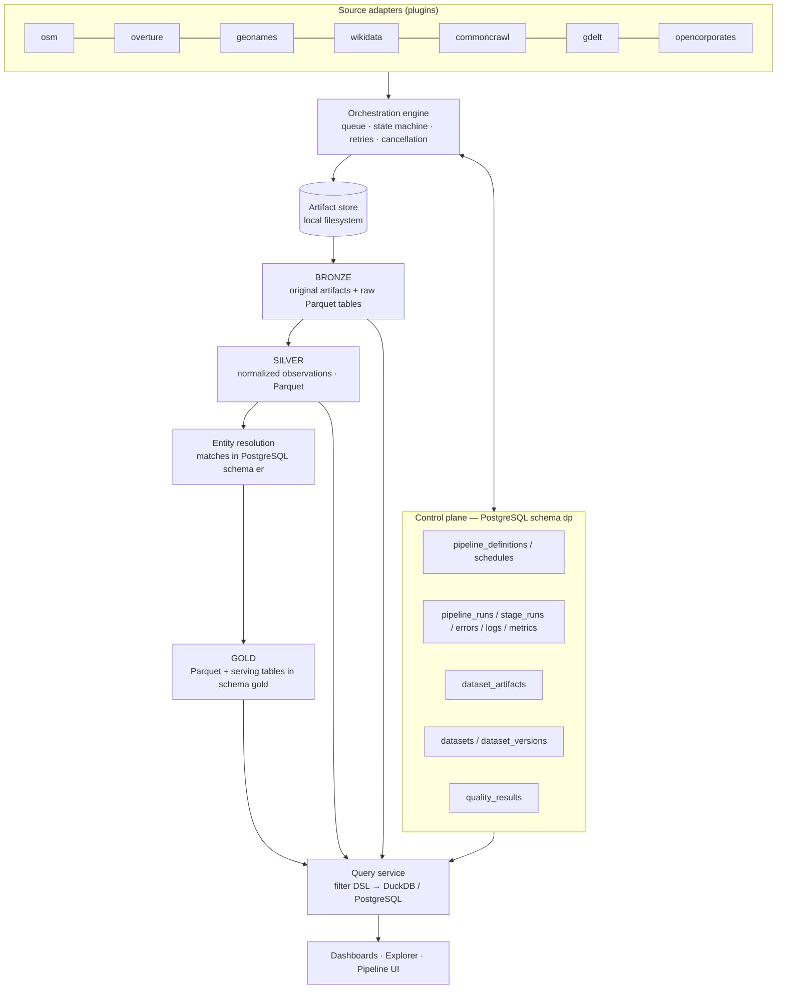

# Data platform — architecture

The other documents in this folder:
- [pipeline-lifecycle](pipeline-lifecycle.md) — stages, state machine, queue, retries, cancellation, idempotency,
  backfills, scheduling
- [medallion-architecture](medallion-architecture.md) — layer rules and the Silver contract
- [storage](storage.md) — the local artifact store and versioned Parquet catalog
- [source-adapters](source-adapters.md) and [adding-a-source](adding-a-source.md)
- [entity-resolution](entity-resolution.md) and [data-quality](data-quality.md)
- [frontend](frontend.md) and [operations](operations.md) — setup, configuration, permissions, observability, runbook

## 1. Starting point (inspected 2026-10-09)

| Area | What existed | Verdict |
|---|---|---|
| Ingestion | `import_osm.py`: one-shot PBF → CSV → `COPY` into `osm_raw.*` (PostgreSQL). There is no run history, no artifact tracking, and it isn't idempotent: re-running it duplicates or conflicts. | Superseded by the OSM source adapter. Kept so the existing dashboard still works. |
| Derivation | `build_companies.py`: SQL that builds `osm_app.companies` and admin polygons | Its taxonomy and geography rules are reused in the OSM Silver transform |
| Database | Local PostgreSQL 15 with PostGIS 3.3 and pg_trgm. Database `ds_companies` is 5.6 GB, mostly `osm_raw`. | Reused for the control plane and serving tables |
| Backend | FastAPI (`backend/app`), psycopg 3 pool, raw SQL, no ORM, no migrations framework | Reused. The platform mounts its router here. |
| Frontend | Next.js 16 / React 19 / Tailwind 4, React Query, Recharts, Leaflet, and a URL-synced filter bar | Reused: shell, UI primitives, charts, maps |
| Workers / queue | None in the repo. Redis and Celery are installed on the machine but unused. | A PostgreSQL job queue is introduced (see D1) |
| Docker | Docker CLI is present but the daemon is not running; there is no compose file | Not required. Everything runs natively. |
| Observability | None | Structured JSON logs, metrics in the control DB, and a Prometheus text endpoint |
| Constraints | **Local only, no paid services or S3.** About 3 GB of free disk. | Hard-links for local artifacts, disk guards, compact Parquet |

## 2. Target architecture

**Control plane** (schema `dp`): what should run, when, its status, artifacts, the dataset catalog, quality results, permissions and saved views. It is small and transactional, and accessed with plain SQL through psycopg.

**Data plane**: Bronze, Silver and Gold Parquet under `DATA_PLATFORM_DATA_DIR` (default `./data`), queried by DuckDB. It also includes the PostgreSQL serving copies of Gold (schema `gold`) and entity matches (schema `er`), which need PostGIS, row-level updates (match decisions) and low-latency indexed lookups.

## 3. Decisions and trade-offs

| # | Decision | Alternatives considered | Why |
|---|---|---|---|
| D1 | **PostgreSQL-backed run queue** (`SELECT … FOR UPDATE SKIP LOCKED`), long-running worker processes | Celery + Redis, Dagster, Prefect | Run creation and enqueueing are one transaction, so no dual-write. It adds no service, and runs are coarse (minutes to hours), not millions of tiny tasks. `TaskQueue` is an interface, so Celery could replace it without touching adapters. |
| D2 | **Parquet + DuckDB** for Bronze, Silver and Gold | Everything in PostgreSQL (status quo) | `osm_raw` is 4 GB in PostgreSQL. The same data in zstd Parquet is roughly 5× smaller, scans are columnar and out-of-core, and the files are lakehouse-compatible (Iceberg/Spark/Trino can read them later). |
| D3 | **Versioned partitions** recorded in `dp.dataset_versions` ("mini table format") | Overwrite in place; Apache Iceberg now | Each build writes to a new directory, and a single control-plane transaction flips `is_current`. That gives atomic publish, snapshot reads, rollback, reproducibility and lineage. It maps 1:1 onto Iceberg snapshots later. |
| D4 | Entity resolution and Gold are **platform stages**, not adapter methods | `build_gold()` per adapter | Gold is inherently cross-source. Adapters contribute through the Silver contract (`silver.places`), so adding a source never touches resolution or Gold. Adapters may still add source-specific Gold extras through an optional hook. |
| D5 | Gold is **scoped by country partition** | Rebuild Gold globally | An OSM Pakistan run rebuilds only `country=PK` across all sources. This is the unit of incremental processing until record-level change data capture (CDC) exists. |
| D6 | Matches live in **PostgreSQL** (`er.entity_matches`) | Parquet | Matches carry human decisions (accepted/rejected) that must survive recomputation and need row updates. At very large scale, candidates move to Parquet and only decisions stay in PostgreSQL. |
| D7 | Geographic enrichment with **Shapely 2** (`build_area`, STRtree) in streaming batches | DuckDB spatial extension, PostGIS round-trips | No extension download is needed, it works offline and in tests, and it is vectorized. |
| D8 | Storage behind `ArtifactStorage`, with **local only** implemented | S3 now | The user asked for local only. Keys are opaque, and no code builds paths by hand. |
| D9 | Bronze lineage columns are `source`, `artifact_id`, `pipeline_run_id`, `ingested_at` (constant per file, effectively free in Parquet). `source_record_id` is derived from table and id. | A string `source_record_id` on 25M+ rows | Saves hundreds of MB on a nearly full disk. Silver materializes `source_record_id`. |
| D10 | Auth is pluggable: `dev` mode (local, all permissions) or `api_key` mode (hashed keys with permission lists) | Full user management | The app has no users yet. Permissions are enforced at the API boundary either way. |

## 4. Milestone 1 implementation plan (all delivered)

1. Foundation: config, structured logging, error taxonomy, state machine, storage, migrations, control-plane repository
2. Engine: queue, worker, stage runner, retry policies, cancellation, progress, heartbeats, stale-run recovery, scheduler
3. Lake: Parquet writer (size-targeted files), dataset catalog with versioned partitions, DuckDB reader
4. Quality framework: reusable checks, per-stage suites, configurable thresholds
5. OSM adapter: discover (Geofabrik index or a local file), download (resumable, checksum-verified), validate, Bronze (pyosmium streaming to Parquet), Silver (DuckDB plus Shapely geography and normalizers)
6. Entity resolution v1, Gold build, serving publish
7. Query service: dataset registry, filter DSL compiler, explorer, dashboards, server-sent events (SSE), permissions, saved views
8. Frontend: Sources, Runs, Run detail (live), Explorer, Dashboards
9. Tests at every step; docs; Makefile; a real run on both Pakistan extracts to prove idempotency and versioning

## 5. Later milestones (all delivered)

| Milestone | Sources | What they add |
|---|---|---|
| 2 | Overture | A second place source: cross-source entity resolution, field-level survivorship and provenance, overlap analytics |
| 3 | GeoNames, Wikidata | The gazetteer becomes the shared geography. Organization records join the Silver contract (`silver.organizations`). Organization linking (`org-v1`) runs alongside location matching. Gold gains organization provenance and cities. |
| 4 | Common Crawl | Domain discovery from the crawl's URL index (range reads of `cluster.idx`, never the corpus). `silver.web_domains` keeps homepage WARC references for later page extraction. |
| 5 | GDELT, OpenCorporates | News-mention signals (incremental 15-minute windows). Registry records fetched through the official API with the operator's own token, a request budget, and a stop at the first quota response. |

Every provider is reached through its official, free distribution channel:

- **Read over HTTPS:** GeoNames dumps, the Wikidata Query Service and API, Common Crawl's public index files, GDELT's
  file feed, and the OpenCorporates API (token required).
- **Kept locally:** everything that is stored.
