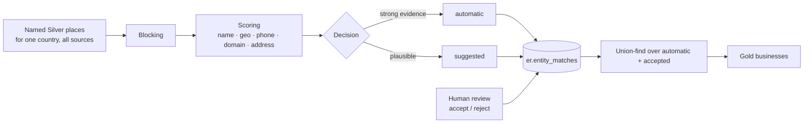

# Entity resolution

Silver keeps every observation separate. Entity resolution (ER) decides which observations describe the same
real-world business, and it never does so irreversibly.

## Algorithm v1 (`resolution/algorithms.py`, version `er-v1`)

**Blocking** keeps comparisons local. Candidate pairs come from four blocks:

- the same `name_key` within roughly 1 km
- the same E.164 phone within roughly 1 km
- the same own (non-platform) domain within roughly 1 km
- a fuzzy name match (Jaro-Winkler ≥ 0.88) within neighbouring ~110 m grid cells

**Scores** for each pair:

| Signal | Score |
|---|---|
| name | Jaro-Winkler of `name_key`. Legal forms are removed, so "Systems (Pvt.) Ltd" becomes "systems". |
| geo | 1 − distance / 300 m; pairs farther than 300 m are not location matches |
| phone / domain / address | 1 if equal, 0 if both present and different, NULL if either is missing |

`match_score` is a weighted mean over the **available** signals (name .45, geo .25, phone .15, domain .10,
address .05). It is multiplied by 0.85 when the category groups differ.

**Decision:**

- `automatic` when any of these holds:
  - name ≥ 0.95 within 75 m, with no phone contradiction
  - the same phone and name ≥ 0.85 within 150 m
  - the same domain and name ≥ 0.85 within 150 m
- Contradicting phone *and* domain is never automatic.
- `suggested` when the score is ≥ 0.70 but none of the above holds.
- Otherwise the pair is dropped.

On Pakistan (OSM only) this produced 2,125 automatic and 2,053 suggested pairs, merging 1,348 clusters. Most were a
shop mapped as a node plus its building way. The same algorithm compares records **across sources** with no changes:
the fixture tests verify that OSM "Systems (Pvt.) Limited" and Overture "Systems Limited" (same name key and domain),
and the same restaurant (same phone, 2 m apart), are linked automatically.

**Survivorship across sources:** OSM ranks above Overture for name, position and category, because those are
community-curated, while Overture's places come largely from social-media pages. Contact fields missing on the
primary record are filled from the other source, and `field_sources` records which source supplied each one.

## Reversibility

- Matches are rows with `status` (`suggested`, `accepted`, `rejected`, `automatic`), scores, `evidence` (blocks,
  categories), `algorithm_version`, `decided_by` and `decided_at`.
- Recomputing updates machine matches but **never overrides** `accepted` or `rejected`. Machine matches that no
  longer hold are removed.
- Gold clusters are the connected components of `automatic` + `accepted` matches (union-find; the root is the
  smallest id, so it doesn't depend on edge order). Rejecting a match changes the ER fingerprint, and the next Gold
  build splits the business. The test suite covers exactly this.
- Review happens in the Explorer (Gold business → provenance → match evidence → Accept or Reject) or through
  `POST /api/data-platform/matches/{id}/decision`.

## Stable Gold ids

`gold_id = "gb_" + sha256(anchor silver_id)[:16]`, where the anchor is the cluster's smallest member id. Ids stay
stable across rebuilds while membership is unchanged; a merge or split changes the ids of the affected clusters only.

## Organizations (`OrganizationLinkingV1`, version `org-v2`)

Location matching (above) decides which records are the **same place**. Organization linking decides which places and
records belong to the **same organization**. It runs in the same ENTITY_RESOLUTION stage whenever
`silver.organizations` exists for the country, and stores its links in `er.entity_matches` with
`match_type = 'organization'`. The links are reviewable and reversible like location matches: accept or reject them in
the explorer.

| Link | Evidence | Status |
|---|---|---|
| place ↔ organization | the place's `brand:wikidata` / `wikidata` tag is the organization's QID | automatic |
| place ↔ organization | same own website domain (platform URLs excluded) | automatic if the names agree (Jaro-Winkler ≥ 0.75), else suggested: portal domains such as `punjab.gov.pk` are shared by hundreds of unrelated offices |
| place ↔ organization | the organization has coordinates (e.g. a school on Wikidata), and a place within 300 m has a similar name | automatic if name ≥ 0.95 and ≤ 150 m, else suggested |
| place ↔ organization | exact name or alias key only; distinctive names (≥ 8 chars) shared by ≤ 25 places | suggested |
| organization ↔ organization | Wikidata's OpenCorporates ID equals the registry record | automatic |
| organization ↔ organization | the registry record was found by searching this Wikidata organization's legal name, and the name matches exactly | automatic |
| organization ↔ organization | same own domain | automatic |
| organization ↔ organization | same name key | suggested |

Organization links **never merge locations**. Two HBL branches linked to the same Wikidata bank remain two businesses
with one `organization_id`. Gold builds organizations as follows:

1. Records linked by organization ↔ organization links are clustered (union-find).
2. Each business gets an organization key, in this order: its brand QID, then the strongest linked record cluster, then
   its brand name, then a domain shared by 2+ locations.
3. A registry record found by searching a Gold organization's own name joins that organization.
4. Clusters that no location links to remain organizations of their own.

## Adding an algorithm

Add a class with `version` and `candidates_sql(places)` to `ALGORITHMS` and expose it in the `er_algorithm` parameter
enum. Runs record the algorithm used, and Gold versions include it in `versions.entity_resolution`. A backfill such as
`start_stage=ENTITY_RESOLUTION, er_algorithm=v2, rebuild_gold=true` rebuilds Gold with the new algorithm without
reparsing anything.

At very large scale, candidate generation moves to partitioned Parquet (blocked by geohash) and only human decisions
stay in PostgreSQL. The interface stays the same.
