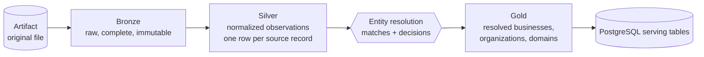

# Medallion architecture

| Layer | Rule | OSM datasets |
|---|---|---|
| Artifact | The original download, checksummed, never overwritten | `bronze/osm/artifacts/<id>/<file>.osm.pbf` |
| Bronze | Everything the source contains, plus lineage columns. Enough to rebuild Silver without downloading again. | `bronze.osm_nodes`, `bronze.osm_ways` (with ordered `node_refs`), `bronze.osm_relations` (with `members`) |
| Silver | Normalized, typed **observations**. No merging across records. | `silver.places`, `silver.rejects`, `silver.geo_boundaries`, `silver.geo_places` |
| Gold | Business-level entities resolved across sources, with provenance | `gold.businesses`, `gold.business_sources`, `gold.organizations`, `gold.domains` |

## Bronze

- Source-specific tables (no giant generic table). Tags stay as a `MAP<string,string>`; nothing is filtered.
- Lineage on every row: `source`, `artifact_id`, `pipeline_run_id` and `ingested_at`. These are constant per file, so
  they cost almost nothing in Parquet. `source_record_id` is derived from the table and id (`n123`, `w45`, `r6`) and
  materialized in Silver.
- Partitioned by `artifact_id`, so every snapshot is kept side by side until it is explicitly deleted.

## Silver: the cross-source contract

Every place-providing adapter writes `silver.places` with the same core columns. `quality/suites.py` enforces them
with `SILVER_PLACES_CONTRACT`:

- **Identity:** `silver_id` (`<source>:<record>`), `source`, `source_record_id`
- **Names:** `name`, `name_local`, `normalized_name`, `name_key` (the matching key without legal forms), `has_name`
- **Classification:** `entity_type`, `category_key`, `category`, `category_group` (shared taxonomy in
  `taxonomy.py`), `subcategory`
- **Geography:** `country_code`, `admin1`, `admin2`, `city`, `locality`, `latitude`, `longitude`
- **Contact:** `website`, `normalized_domain` (registrable domain; private public suffixes count, so
  `shop.myshopify.com` is its own site), `tld`, `domain_is_platform` (social networks, webmail, link shorteners, site
  builders and marketplaces: an address there is not the business's own domain), `phone`,
  `normalized_phone` (E.164), `email`, `social_links`, the address fields, `opening_hours`
- **Brand:** `brand_name`, `brand_wikidata`, `operator`, `wikidata`
- **Provenance:** `source_confidence`, `source_updated_at`, `source_version`, `artifact_id`, `bronze_version_id`,
  `pipeline_run_id`, `transformation_version`, `ingested_at`
- `attributes`: all original source attributes as JSON, so unknown fields are never lost

Records that cannot be normalized go to `silver.rejects` with a `reason`; they are not dropped silently. Silver is
partitioned by `source` and `country` (the run scope).

The contract schemas live in `silver_contract.py` (`CONTRACT_VERSION`), and both adapters import them.

Geography is normalized by `geo.py`. It assigns country, admin1 and admin2 by point-in-polygon against boundary
polygons, which are built from OSM relations with Shapely `build_area`. It assigns `city` as the nearest city within a
population-scaled radius, and `locality` as the nearest city or town. Boundaries and cities are shared Silver
datasets (`silver.geo_boundaries`, `silver.geo_places`): OSM produces them, and every other source loads them through
`silver_contract.load_geo_index(country)`, so all sources get identical admin and city assignment. When GeoNames is
loaded, its gazetteer takes precedence for populated places (`GEO_PLACE_PRECEDENCE`). Nearest-place lookups use a
spatial tree, because the gazetteer has 150k villages.

Sources that describe something other than a location write their own shared contracts (also in
`silver_contract.py`):

| Dataset | Written by | One row per |
|---|---|---|
| `silver.organizations` | Wikidata, OpenCorporates | organization record (company, brand, institution): names, aliases, legal name, types, industries, website/domain, HQ, coordinates, inception, status, registry id, parent, identifiers |
| `silver.web_domains` | Common Crawl | registrable domain seen by the crawler: pages, hosts, languages, status mix, homepage + its WARC reference, domain type, business-candidate flag |
| `silver.org_mentions` | GDELT | normalized organization name: mentions, articles, outlets, first/last seen, tone, themes, places |
| `silver.geo_places` | GeoNames, OSM | populated place: kind, population, local name, admin names, alternate names |
| `silver.postal_codes` | GeoNames | postal code with place and admin names |

## Gold

- `gold.businesses`: one row per resolved real-world location. Attributes are chosen by survivorship, ranked by source
  priority (`gold/builder.py: SOURCE_PRIORITY`) and then by completeness. `sources`, `source_count`, `member_count`
  and `conflicts` (fields where members disagree) are recorded.
- **Field-level provenance:** `gold.businesses.field_sources` records which source supplied each attribute, e.g.
  `{"name": "osm", "website": "overture", "phone": "osm", …}`. `source_confidence` is the best provider confidence.
  Clusters whose members all have provider confidence below 0.3 stay in Silver but are not promoted to Gold. OSM, with
  no per-record confidence, counts as 1.0.
- `gold.business_sources`: **provenance**. Every Silver record behind each business, with its artifact, run,
  transformation version and match confidence.
- `gold.businesses.enriched_by` lists the **non-location sources** that describe a business: `wikidata` and
  `opencorporates` (through its organization, or the place itself being a Wikidata item, recorded in `wikidata_id`),
  `gdelt` (its organization is in the news) and `commoncrawl` (its website is crawled). This answers "how many OSM
  records were enriched by Wikidata?".
- `gold.organizations`: companies, brands and institutions. They merge what locations imply (brand, shared website)
  with what Wikidata and registries state:
  - **Field-level survivorship:** name from Wikidata, then locations; legal name and registry id from OpenCorporates;
    description, industry, HQ, inception and identifiers from Wikidata.
  - **News signals** from GDELT: mentions, articles, last seen, tone.
  - **Knowledge-base-only organizations** (Wikidata or registry records that no location links to) are kept with
    `location_count = 0`: that's discovery.
  - `field_sources` names the source of each attribute.
- `gold.organization_sources`: **organization provenance**. Every Wikidata or registry record behind an organization,
  with how it was linked (`link_method`: wikidata_id, domain, name_geo, identifier, registry_search, standalone…).
- `gold.domains`: domains used by businesses, stated by organizations, **or discovered by the crawl**. Each has
  business and organization counts, crawl pages, languages, homepage status, domain type and the business-candidate
  flag. Crawl-only domains are leads.
- `gold.cities`: cities and towns from the preferred gazetteer, with population, business count, website and phone
  coverage, and **businesses per 10,000 residents**. Same-named places attribute businesses to the most populous one.

Gold is partitioned by `country`. A run rebuilds only its own country from **all** sources' Silver for that country.
This is the unit of incremental processing (see [storage.md](storage.md)).

## Reproducibility

Each run records `versions = {parser, transformation, entity_resolution, gold}`. Each dataset version records its
`versions` and its `inputs`: the artifact id with its SHA-256, upstream dataset version ids, and the ER algorithm and
decision fingerprint. A Gold row can therefore be traced back to the exact artifact and code versions that produced it.
`GET /runs/{id}/lineage` returns that graph.
